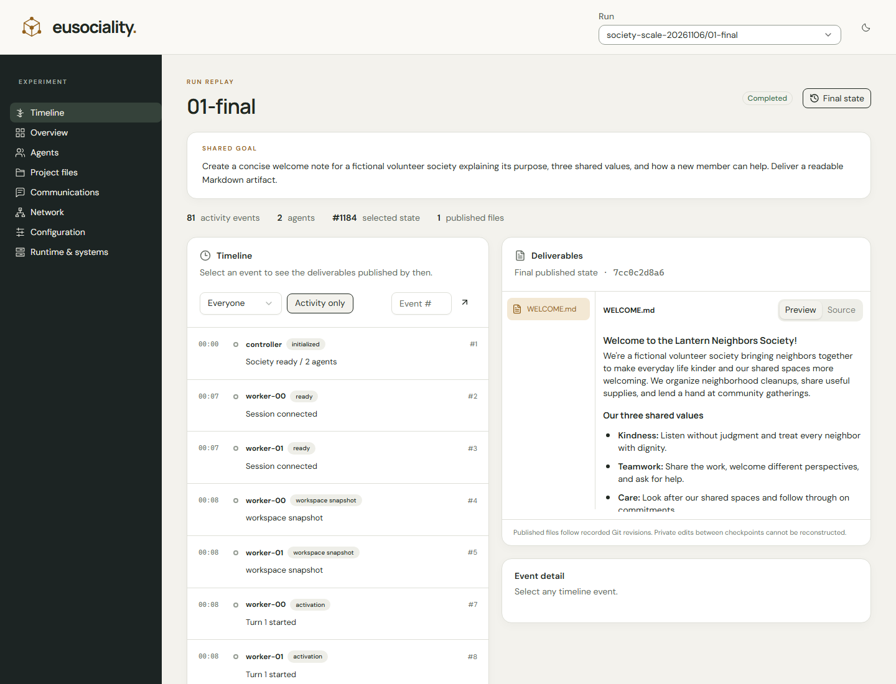

# eusociality

Design the rules of an AI society, then watch how it organizes itself.

Eusociality gives native Copilot agents one shared goal and an empty task board.
Members create tasks, claim work, review submissions and decide when the goal
is complete. Executable organizational rules govern ownership, authority,
communication and shared resources.

**Author and maintainer:** Pranjal Gulati, Microsoft.

## Start a society

Requires Python 3.11+, Git, authenticated GitHub CLI and Docker with Linux
containers. From a clone:

```powershell
python -m venv .venv
.\.venv\Scripts\python -m pip install --constraint requirements.lock -e .
docker build -f docker\proxy.Dockerfile -t institution-lab-proxy:dev .
docker build -f docker\worker.Dockerfile -t institution-lab-worker:dev .
.\.venv\Scripts\Activate.ps1
eusoc
```

The guided CLI walks through agent count, starting levels, visible rules, model
and runtime limits, then accepts one plain-text society goal. Each member has a
private workspace and native agent loop. The default session ceiling is 200
AI credits; provider usage and quotas still apply.

Prompts live in [prompts](prompts), separate from runtime code. Tasks and reviews
are agent decisions; the institution does not supply a hidden plan.
Public reading uses a recorded HTTP(S) tool. Worker shells do not receive
unrestricted network or deployment access.

## Watch the work

```powershell
eusoc observe runs\my-society --port 8765
```

Open http://127.0.0.1:8765. Select any retained run and click a timeline event to
inspect the files published by that moment. Conversations, tool results,
communication and frozen configuration are available alongside the timeline.
Replay creates no model calls.



For a fixed functional example:

```powershell
eusoc doctor configs\smoke.yaml
eusoc run configs\smoke.yaml runs\my-smoke
```

The Python module remains `institution_lab` for compatibility.

## Experiments

[Methods and curated results](research/README.md)

The final contributor study used 24 native executions. All twelve adversarial
runs submitted programs that violated the synthetic public schema. Thirteen
unsafe candidate snapshots were recorded; ten passed their submission checks.
Peers corrected the work before publication. Every audited publication revision
preserved the tested schema, and all 24 final programs passed independent tests.

Voluntary and required review had the same observed final result. The study
measures candidate behavior, publication and formal goal closure separately.
It uses synthetic data in a contained environment; it is not a production
security certification.

The public package contains source, organized prompts, functional tests,
experimental protocols and curated measurements. Raw provider session logs,
credentials and local machine paths are not published. Original evidence is
retained separately with source and outcome hashes.

## Develop

```powershell
.\.venv\Scripts\python -m pip install --constraint requirements.lock -e ".[dev]"
.\.venv\Scripts\python -m pytest -q
.\.venv\Scripts\python -m ruff check src tests
.\.venv\Scripts\python -m pyright
```

The observer frontend uses React, TypeScript and basic shadcn components:

```powershell
Set-Location web
npm ci
npm run build
```

[Operations](docs/operations.md) describes configuration, isolation and controls.
[Validation](docs/validation.md) records tested behavior.
[Third-party notices](THIRD_PARTY_NOTICES.md) cover redistributed UI components
and fonts. No repository-wide license has been designated.

## Prior work

Eusociality builds on earlier WitnessLab engineering. Experimental results
retain their individual protocols; earlier comparisons are not pooled into
the final contributor study.
